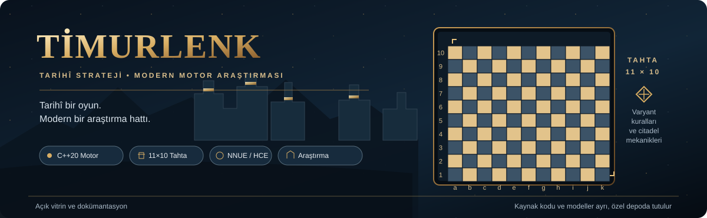
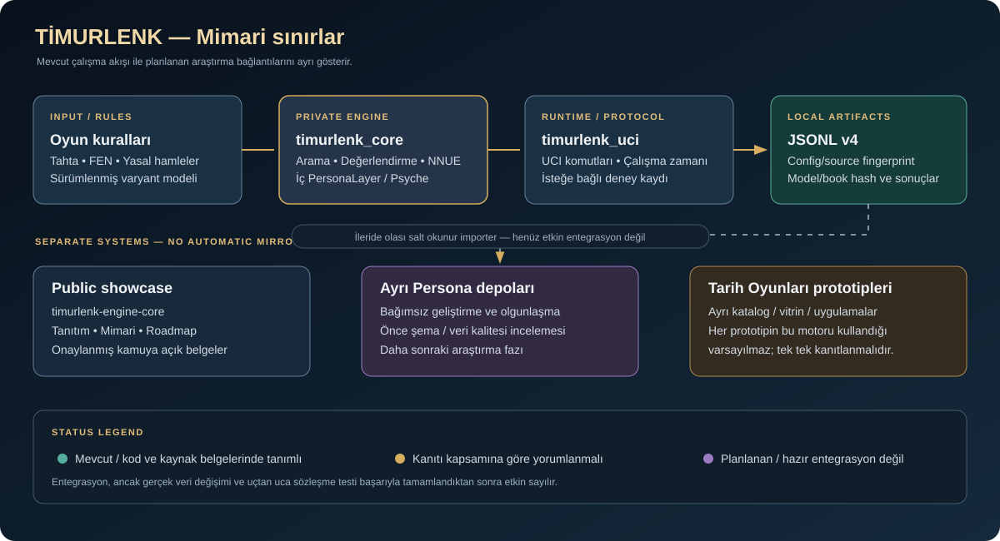

<!--
Public showcase only.
The engine source of truth is the access-controlled repository linked below.
Do not copy private source, model files, credentials, private logs, or full audit artifacts here.
-->

  

# Timurlenk Engine Core

**Tarihî strateji. Modern motor araştırması.**  
TİMURLENK, Timur Satrancı olarak modellenen 11×10 tahtalı ve iki özel citadel karesi bulunan tarihî satranç varyantı için geliştirilen araştırma odaklı bir motor projesidir.

> **Bu depo projenin açık vitrinidir; motorun kaynak kodu deposu değildir.** Mimari özeti, kapsamı, araştırma yol haritasını ve kamuya açık olması uygun görülen belgeleri barındırır. Aktif C++ geliştirmesi ve model dosyaları ayrı, erişim kontrollü depoda kalır.

  <a href="docs/PROJECT_OVERVIEW.md">Proje Özeti</a> ·
  <a href="docs/ARCHITECTURE_PUBLIC.md">Mimari</a> ·
  <a href="docs/ROADMAP.md">Yol Haritası</a> ·
  <a href="docs/ELO_VALIDATION_PLAN.md">Oyun Gücü Araştırma Planı</a> ·
  <a href="docs/PUBLIC_RELEASE_POLICY.md">Yayın Politikası</a>

## Projenin amacı

TİMURLENK'in amacı, tarihî bir strateji oyununu modern C++ motor mühendisliği ve tekrarlanabilir araştırma yöntemleriyle bir araya getirmek. Motorun oyun kuralları, arama ve değerlendirme davranışı, model kullanımı ve deney kayıtları ayrı ayrı incelenir; sonuçlar, kanıtın izin verdiğinden daha güçlü iddialar olarak sunulmaz.

### Öne çıkan alanlar

| Alan | Kapsam |
|---|---|
| Tarihî oyun modeli | 11×10 tahta, özel taş hareketleri ve citadel kuralları |
| Motor çekirdeği | Tahta/durum, yasal hamleler, arama, hamle sıralama ve zaman yönetimi |
| Değerlendirme | HCE ve bilişsel NNUE yolları |
| Protokol | UCI üzerinden motor kontrolü ve deney yürütme |
| Araştırma | Self-play, sabit-konum analizleri, model/hash kaydı ve regresyon testleri |
| Modüler tasarım | Çekirdek motor, protokol, hamle gösterimi ve self-play sorumluluklarının ayrılması |

## Mimariyi gör

  

Mimarideki **mevcut** motor akışı ile **geleceğe bırakılmış** entegrasyon fikirleri bilerek ayrılmıştır. Bir şema, tasarım sözleşmesi veya dosyanın varlığı çalışan bir bağlantı olduğu anlamına gelmez.

## Depo sınırları

| Depo / proje ailesi | Rol |
|---|---|
| **Bu depo — `timurlenk-engine-core`** | Herkese açık tanıtım, mimari özet, yayın politikası ve araştırma yol haritası |
| [Özel Timurlenk motor deposu](https://github.com/mehmetkync172-cmd/timurlenk-engine-private) | C++ kaynak kodu, testler, model/kitap dosyaları, deney araçları ve etkin geliştirme |
| **Persona araştırma depoları** | Ayrı projeler olarak geliştiriliyor; olgunlaşma ve ayrı bir entegrasyon kararı gelene kadar Timurlenk'e bağlanmayacak |
| **Tarih Oyunları prototip ailesi** | Ayrı oyun/vitrin hattı; her prototipin bu C++ motorunu kullandığı varsayılmaz |

### Persona hakkında önemli ayrım

Timurlenk motorundaki `Apex::PersonaLayer`, motorun iç oyun stili, Psyche ve arama/değerlendirme parametreleri katmanıdır. Ayrı Persona araştırma sistemi değildir. Mevcut motor kaynak durumuna göre, iki sistem arasında çalışan doğrulanmış API veya otomatik veri aktarımı yoktur. Bu entegrasyon **bilinçli olarak sonraki aşamaya bırakılmıştır**; iki Persona deposunun olgunlaşması, veri sözleşmesinin gözden geçirilmesi ve uçtan uca doğrulama şarttır.

Daha fazla bağlam: [Persona entegrasyonu için sonraki oturum devir notu](docs/PERSONA_INTEGRATION_HANDOFF.md).

## Güncel durum — 24 Ekim 2026

- Özel motor deposunun güncel `main` HEAD'i: [`8ea25deb331be42306c0ecd7edf8faa7282569e5`](https://github.com/mehmetkync172-cmd/timurlenk-engine-private/commit/8ea25deb331be42306c0ecd7edf8faa7282569e5). Bu commit yalnızca manuel güç ölçüm workflow dosyasını varsayılan dala ekler; araştırma dalındaki motor kodunu birleştirmez.
- Güncel güç ölçüm çalışması [`research/strength-measurement-v1-clean`](https://github.com/mehmetkync172-cmd/timurlenk-engine-private/tree/research/strength-measurement-v1-clean) dalında kalır ve henüz `main` ile birleştirilmemiştir.
- GitHub Actions manuel çalıştırması, hesabın Actions harcama limiti/ödeme durumu nedeniyle job başlamadan engellendi. Bu sebeple güncel strength harness için başarılı CI sonucu henüz yoktur.
- Önceki yerel kaynak snapshot'ında CTest 12/12, model manifesti 23/23 ve UCI smoke 6/6 kontrolleri geçmişti. Bu sonuçlar araştırma dalındaki yeni strength harness'in doğrulandığı anlamına gelmez.
- Persona entegrasyonu etkin değildir; doğrulanmış API veya otomatik veri aktarımı yoktur.
- **ELO / mutlak oyun gücü belirlenmiş değildir.** Renk değişimli, eşleştirilmiş ve yeterli örneklemli maç kanıtı elde edilmeden güç artışı iddiası yapılmaz.

Ayrıntılar: [özel depodaki güncel durum belgesi](https://github.com/mehmetkync172-cmd/timurlenk-engine-private/blob/main/engine-v7/STATUS.md) ve [Oyun Gücü Doğrulama Planı](docs/ELO_VALIDATION_PLAN.md).

## Nereden başlamalı?

1. Projenin sınırlarını anlamak için [Proje Özeti](docs/PROJECT_OVERVIEW.md) dosyasını aç.
2. Modül sorumlulukları için [Genel Mimari](docs/ARCHITECTURE_PUBLIC.md) belgesini incele.
3. Model/deney kanıtlarının nasıl yorumlanacağını ve planlanan araştırma aşamalarını [Yol Haritası](docs/ROADMAP.md) ile [Oyun Gücü Planı](docs/ELO_VALIDATION_PLAN.md) üzerinden takip et.
4. Bir dosyanın herkese açık yayımlanmasına ilişkin kuralları [Public Release Policy](docs/PUBLIC_RELEASE_POLICY.md) içinde gör.

## Yayın ilkesi

Bu depo özel motor deposuyla otomatik olarak eşitlenmez. Kaynak kodu, model ağırlıkları, açılış kitapları, eğitim verileri, özel kayıtlar ve kimlik bilgileri ayrıca incelenip açıkça onaylanmadan buraya kopyalanmaz. Her teknik iddia; güncel kaynak, kapsamı belli test sonucu ve yeniden üretilebilir kanıt ile ilişkilendirilmelidir.

**Lisans notu:** Bu depoda şu an bir lisans dosyası tanımlı değil. Doküman veya görselleri yeniden kullanmadan önce hak sahibinden izin alın; açık kaynak lisansı olduğu varsayılmamalıdır.
